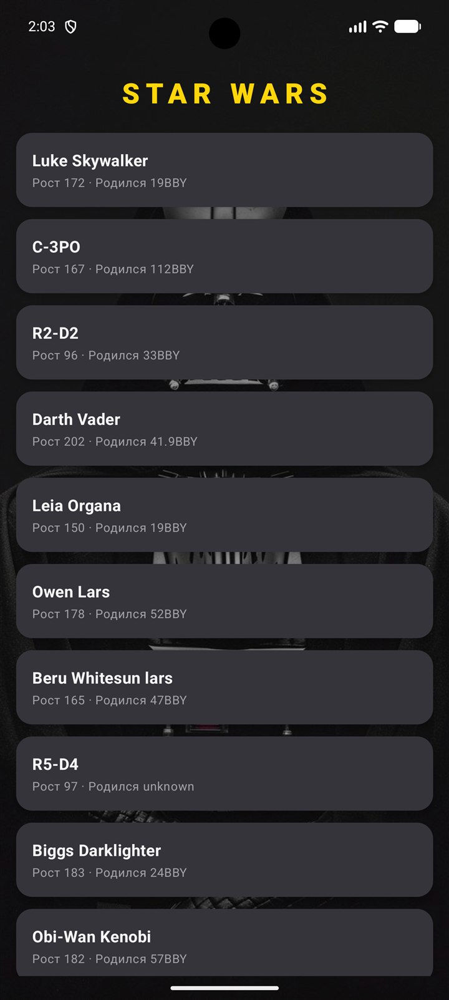
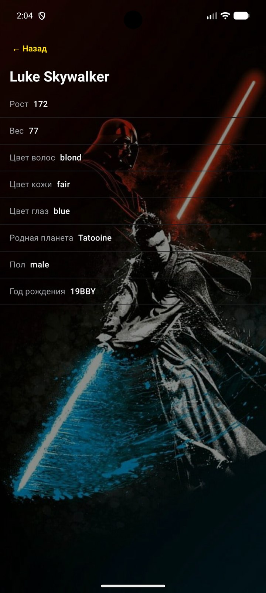
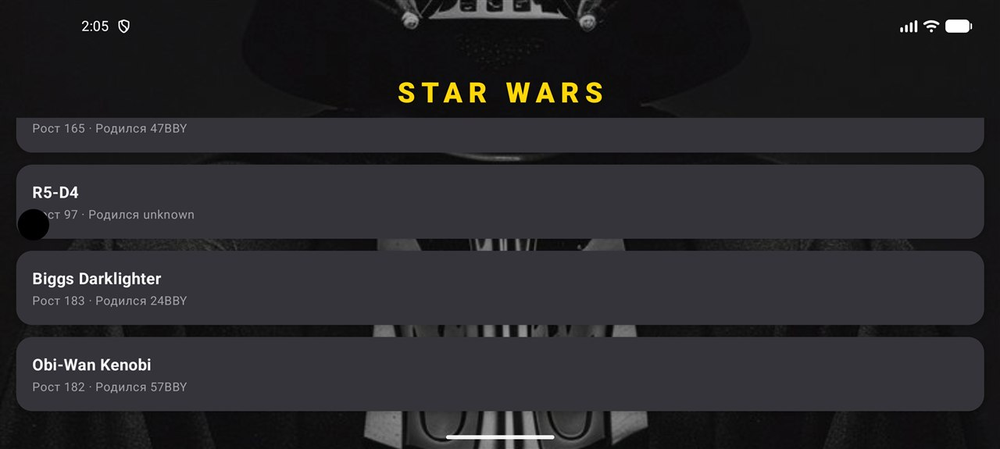
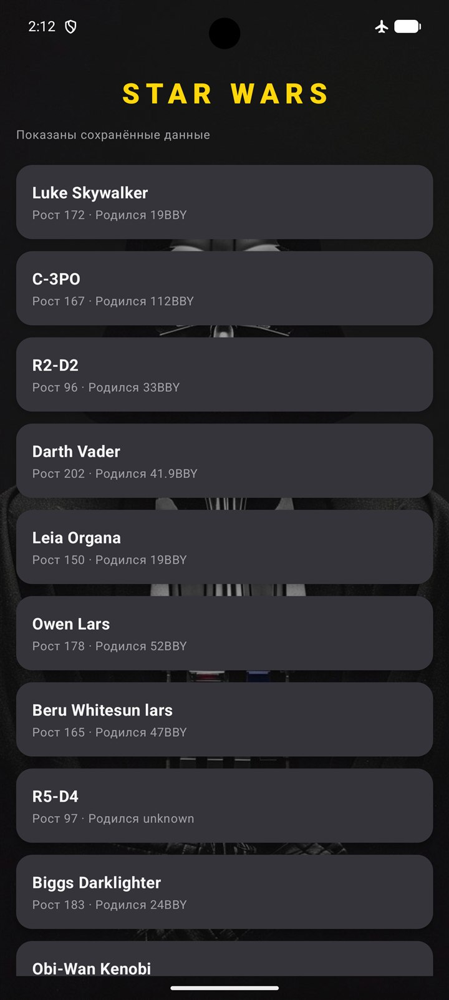
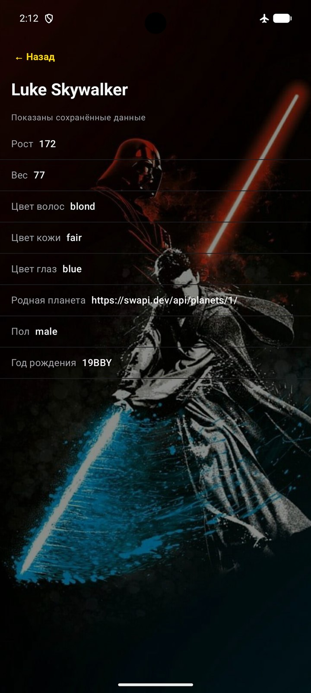
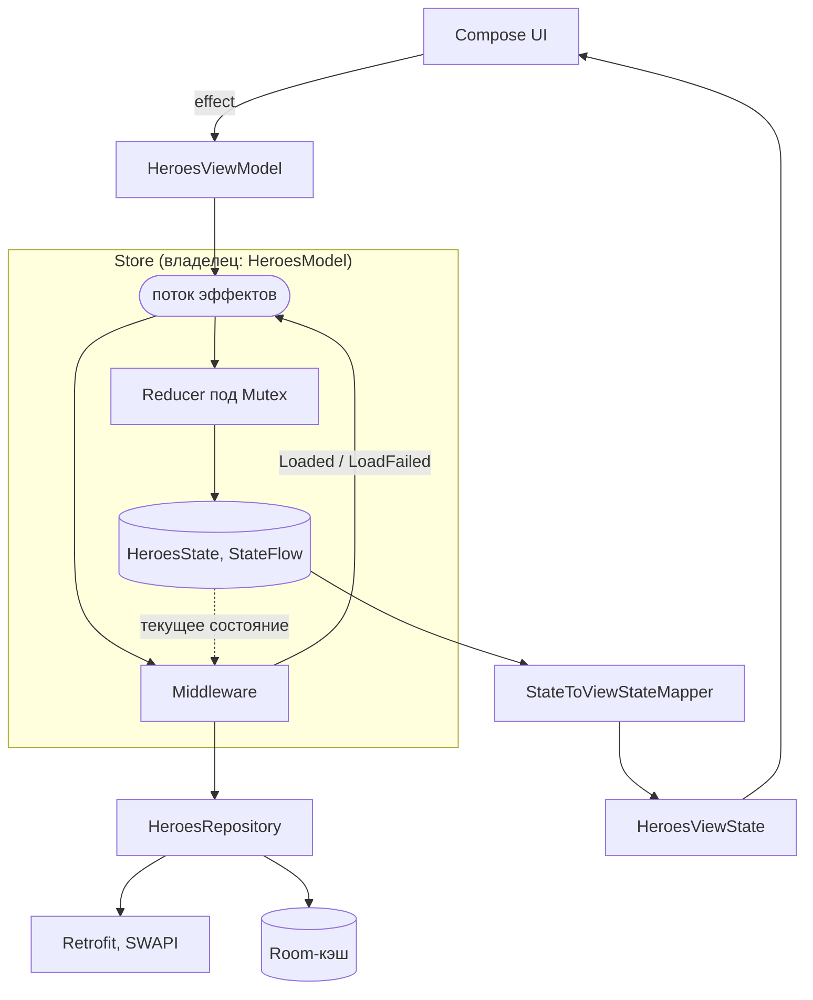
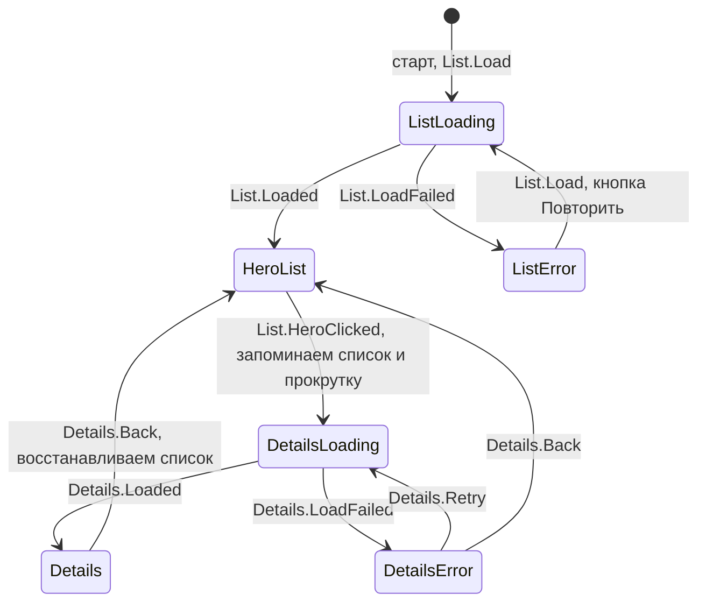

# StarWars-MVI

Android-приложение со списком героев «Звёздных войн». Проект учебный: на нём отрабатывается чистый MVI на Kotlin Flow, разбиение на Gradle-модули и внедрение зависимостей через Dagger без Hilt.

Данные берутся из открытого [SWAPI](https://swapi.dev/). Без интернета приложение показывает сохранённые ранее данные из локальной базы и честно помечает это плашкой «Показаны сохранённые данные».

## Скриншоты

<table>
  <tr>
    <td align="center"></td>
    <td align="center"></td>
  </tr>
  <tr>
    <td align="center">Список героев</td>
    <td align="center">Карточка героя</td>
  </tr>
</table>

Горизонтальная ориентация. Список сохраняет позицию прокрутки: после возврата с карточки героя он остаётся на том же месте, а не прокручивается в начало:



Офлайн-режим (в режиме полёта данные берутся из кэша, об этом говорит плашка «Показаны сохранённые данные»). Название родной планеты в кэш не попадает, поэтому без интернета вместо него показывается ссылка:

<table>
  <tr>
    <td align="center"></td>
    <td align="center"></td>
  </tr>
  <tr>
    <td align="center">Список из кэша</td>
    <td align="center">Карточка из кэша</td>
  </tr>
</table>

## Видео

- [Горизонтальная ориентация](docs/videos/landscape-demo.mp4) (22 с): прокрутка списка героев, открытие карточки и возврат к списку.
- [Работа без интернета](docs/videos/offline-demo.mp4) (51 с): включение режима полёта, повторный запуск приложения и карточка героя из кэша.

Видео открываются в плеере прямо на GitHub по клику на ссылку.

## Возможности

- Один экран без навигационных библиотек: карточка героя — это следующий шаг внутри того же экрана. Системная кнопка «Назад» на карточке возвращает к списку.
- Список героев с прокруткой. Позиция списка запоминается: после возврата с карточки вы оказываетесь там же, где были.
- Карточка героя: рост, вес, цвет волос, кожи и глаз, год рождения, пол и родная планета (название планеты подгружается отдельным запросом).
- Офлайн-режим: список и ранее открытые герои читаются из Room, когда сети нет.
- Состояния загрузки и ошибки с кнопками «Повторить» и «Назад». Сетевая ошибка, ошибка сервера (с кодом) и неизвестная ошибка показываются разными текстами.
- Загрузка привязана к экрану: если выйти, не дождавшись списка, запрос отменяется и список не загружается (подробнее в разделе [«Жизненный цикл и отмена загрузки»](#жизненный-цикл-и-отмена-загрузки)).
- Тёмная тема в стиле Star Wars и фоновые картинки.

## Стек

| Область | Что используется |
|---|---|
| Язык | Kotlin 2.2.10 |
| UI | Jetpack Compose (Material 3), `ComposeView` внутри `Fragment` |
| Асинхронность | Kotlin Coroutines и Flow |
| DI | Dagger 2.57 (KSP), компонентные зависимости и сабкомпоненты |
| Сеть | Retrofit 3, OkHttp 5, Gson |
| Хранилище | Room 2.8 |
| Сборка | Gradle 9.4.1, AGP 9.2.1, version catalog (`gradle/libs.versions.toml`) |
| Платформа | minSdk 24, targetSdk 37, JDK 21 |

## Архитектура

### Модули

```
:app ──────────────► :heroes:impl ──► :heroes:api ──► :core
  │                       │                              ▲
  └──► :core:android ◄────┘                              │
            └────────────────────────────────────────────┘
```

| Модуль | Тип | Содержимое |
|---|---|---|
| `:app` | Android-приложение | `Application`, `MainActivity`, корневой `AppComponent` Dagger, модули сети и базы, реализации логгера и диспетчеров |
| `:core` | Kotlin-библиотека | Контракты MVI (`Store`, `Reducer`, `Middleware`, `Model`), `StarHero`, `NetworkResult`/`NetworkError`, интерфейсы `AppLogger` и `AppDispatchers`, DI-скоупы и каркас фич |
| `:core:android` | Android-библиотека | Тема Compose и `ComponentProvider` для получения компонентов фич из `Application` |
| `:heroes:api` | Kotlin-библиотека | Публичный контракт фичи: `HeroesApi`, `HeroesScreenComponent`, `HeroesRepository` |
| `:heroes:impl` | Android-библиотека | Всё остальное по фиче: данные (Retrofit, Room), MVI, ViewModel, UI, DI фичи |

Фича `heroes` разрезана на `api` и `impl`. Снаружи видны только интерфейсы, а реализация спрятана за `internal`.

### MVI

В основе лежит `Store` из `:core`. Он работает с тремя типами данных:

- **Effect** — любое событие: действие пользователя (`List.Load`, `List.HeroClicked`, `Details.Retry`, `Details.Back`) и результат работы middleware (`List.Loaded`, `List.LoadFailed`, `Details.Loaded`, `Details.LoadFailed`). Все изменения состояния идут только через эффекты.
- **Reducer** — чистая функция `(effect, state) -> state`. Корневой редюсер только раздаёт эффекты двум саб-редюсерам: для списка и для карточки. Эффекты обрабатываются строго по одному (под `Mutex`), гонок нет.
- **Middleware** — функция `(Flow<Effect>, Flow<State>) -> Flow<Effect>`. Через неё выполняются побочные действия (запросы в сеть): она слушает поток эффектов и порождает новые. В проекте два middleware: `LoadHeroesMiddleware` (список) и `LoadHeroDetailsMiddleware` (карточка).



Основные решения:

- **ViewModel без логики.** Она только отдаёт состояние и принимает эффекты. Первая загрузка запускается не из `init` ViewModel, а как стартовый эффект `List.Load` (`initEffects`) самого `Store`.
- **Состояние для Compose собирается мапперами** в `HeroesViewState` (готовые строки и неизменяемые списки), поэтому UI ничего не знает про сеть и кэш. Тексты ошибок появляются только здесь и в `strings.xml`, а не в слое данных.
- **Падение middleware не роняет экран.** `Store` логирует ошибку и перезапускает middleware (по умолчанию до 3 раз), а скоуп `Model` построен на `SupervisorJob`.
- **Новый запрос отменяет старый.** В middleware используется `mapLatest`: повторный `Load` или `Retry` отменяет ещё не законченный запрос.
- **Запоздалый ответ не ломает экран.** Редюсер карточки применяет `Details.Loaded` и `Details.LoadFailed` только если текущий шаг — `DetailsLoading`. Если шаг уже сменился, ответ игнорируется.
- **Данные текущего события — из самого эффекта.** `LoadHeroDetailsMiddleware` берёт ссылку на героя из `HeroClicked`, а не из состояния: `Store` не гарантирует, что редюсер успеет обработать эффект раньше, чем middleware прочитает состояние. Из состояния читаются только данные, записанные более ранними эффектами (так делается для `Retry`).

### Состояния экрана

Весь экран описывается одним `HeroesState`. Текущий шаг лежит в `step`, а список с позицией прокрутки сохраняется в `previousListStep`, пока открыта карточка.



`ListLoading` и `DetailsLoading` на экране выглядят одинаково (общий индикатор загрузки). В шагах `HeroList` и `Details` есть признак `fromCache`: по нему показывается плашка «Показаны сохранённые данные».

### Жизненный цикл и отмена загрузки

`HeroesModel` владеет `Store` и его `CoroutineScope`. Когда ViewModel уничтожается, она в `onCleared()` вызывает `interactor.cancel()`, и скоуп гаснет целиком: перестают работать подписки middleware, редюсер и все запросы в сети.

Что это значит для пользователя:

- **Пользователь вышел с экрана, не дождавшись списка.** Загрузка отменяется, список не загружается и в кэш не записывается. Фоновой догрузки нет: при следующем открытии экрана загрузка начнётся заново.
- **Кэш при этом не портится.** Запись в Room идёт одной транзакцией (очистка и вставка вместе), поэтому в базе остаётся либо старый список, либо новый, но никогда не пустая таблица.
- **Поворот экрана и сворачивание приложения** загрузку не обрывают: ViewModel переживает пересоздание активности, и состояние сохраняется.

### Данные и кэш

`HeroesRepositoryImpl` работает по схеме «сначала сеть, кэш только как запасной вариант». Исключений наружу он не бросает: результат всегда `NetworkResult.Success` или `NetworkResult.Error`.

1. Сначала всегда запрос в сеть.
2. Успех: кэш в Room перезаписывается (очистка и вставка в одной транзакции), пользователь получает свежие данные.
3. Нет интернета: берутся данные из кэша с пометкой `fromCache = true`. Если кэш пуст, возвращается исходная ошибка.
4. Сервер ответил ошибкой (4xx/5xx): кэшем она не маскируется, ошибка показывается как есть.

Кэш обновляет только загрузка списка, а карточка героя его не трогает. Если интернета нет, карточка берётся из кэша списка (если этот герой там есть).

Что видит пользователь в разных ситуациях:

| Ситуация | Результат на экране |
|---|---|
| Запуск с интернетом | Индикатор загрузки, затем список |
| Запуск без интернета, кэш есть | Список из кэша и плашка «Показаны сохранённые данные» |
| Запуск без интернета, кэша нет | Экран ошибки «Нет подключения к интернету» и кнопка «Повторить» |
| Сервер ответил ошибкой | Экран ошибки «Ошибка сервера: код» и кнопка «Повторить». Кэш не показывается |
| Открыта карточка, интернета нет | Карточка из кэша списка с плашкой. Название планеты не показывается, вместо него ссылка |
| Ошибка при загрузке карточки | Экран ошибки с кнопками «Повторить» и «Назад» |
| Выход с экрана до конца загрузки | Загрузка отменяется, список не загружается, кэш не меняется |

### Внедрение зависимостей

Выбран чистый Dagger, а не Hilt: фича объявляет интерфейс зависимостей (`HeroesDependencies`) и ничего не знает об остальных модулях, а Hilt привязан к фиксированным Android-компонентам и строит граф через app-модуль.

- `AppComponent` (`@Singleton`) собирает сеть, базу, логгер, диспетчеры и репозиторий и отдаёт карту компонентов фич.
- `StarWarsApp` реализует `ComponentProvider`, а фрагмент достаёт нужный компонент через `application.getComponent(HeroesApi::class.java)`.
- `HeroesComponent` (`@FeatureScope`) получает зависимости через `HeroesDependencies`, то есть фича не знает про `AppComponent`. Создаётся он один раз через `HeroesContainer` (потокобезопасный `DoubleCheckContainer`).
- Для каждого экрана создаётся сабкомпонент (`HeroesScreenComponent`) со временем жизни `ViewModel`. Он собирает набор middleware, `HeroesModel` и `HeroesViewModel`.
- Новая фича подключается в приложение добавлением её модуля в `AppComponent`.

## Структура репозитория

```
app/                приложение и корневой DI
core/               контракты и общий код
  android/          тема и ComponentProvider
heroes/
  api/              публичный контракт фичи
  impl/
    data/           Retrofit, Room, DTO, мапперы, HeroesRepositoryImpl
    mvi/            State, Effect, Reducer, Middleware, Model
    di/             Dagger-компоненты и модули фичи
    content/        Compose-экраны (список, детали, загрузка, ошибка)
    submappers/     State → ViewState
docs/screenshots/   скриншоты для README
docs/videos/        демо-ролики для README
gradle/             version catalog и wrapper
```

## Сборка и запуск

Нужны Android Studio (свежая версия, совместимая с AGP 9.2) и Android SDK 37. JDK 21 Gradle скачает сам (настроено через `foojay-resolver`).

1. Клонируйте репозиторий:
   ```bash
   git clone https://github.com/RomanBoris/StarWars-MVI.git
   ```
2. Откройте папку в Android Studio и дождитесь синхронизации Gradle.
3. Запустите конфигурацию `app` на эмуляторе или устройстве (Android 7.0+).

Сборка из консоли:

```bash
./gradlew assembleDebug
```

На Windows используйте `gradlew.bat assembleDebug`.

Приложению нужен доступ в интернет при первом запуске, чтобы наполнить кэш.

## Ветки

Основная ветка — `main`. Остальные ветки (`mvi-foundation`, `heroes-ui`, `gradle-modules`, `effect-state-feature`, `dagger-di`, `final-acceptance`) отражают этапы разработки и уже влиты в `main`.

## Ограничения

- Загружается только первая страница списка SWAPI (`page=1`), то есть первые 10 героев.
- Название родной планеты не кэшируется: оно подгружается отдельным запросом, и без интернета в карточке остаётся ссылка на планету.
- Загрузка не продолжается в фоне: если выйти с экрана до её окончания, она отменяется.
- Автоматических тестов пока нет, в проекте лежат только шаблонные `ExampleUnitTest` и `ExampleInstrumentedTest`.
